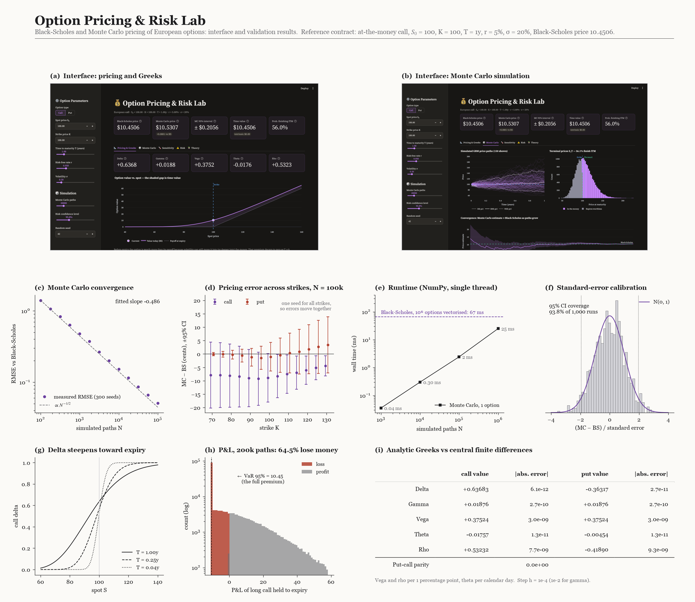
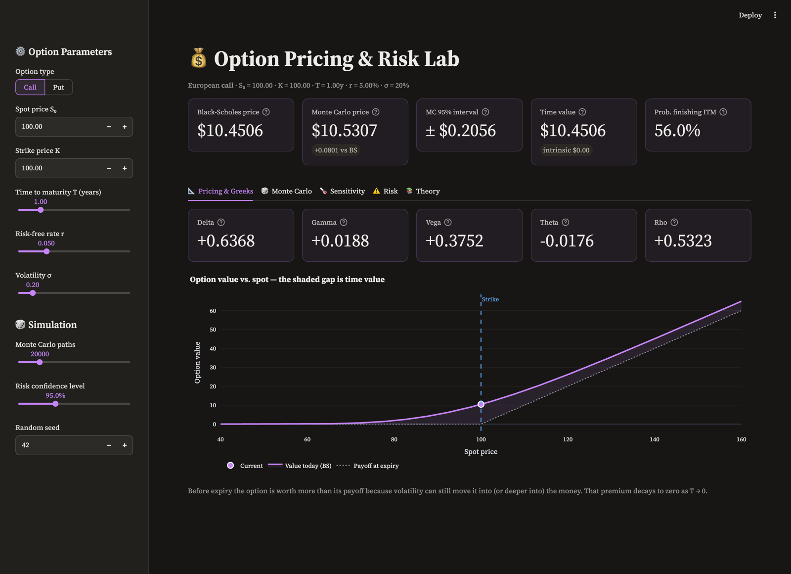
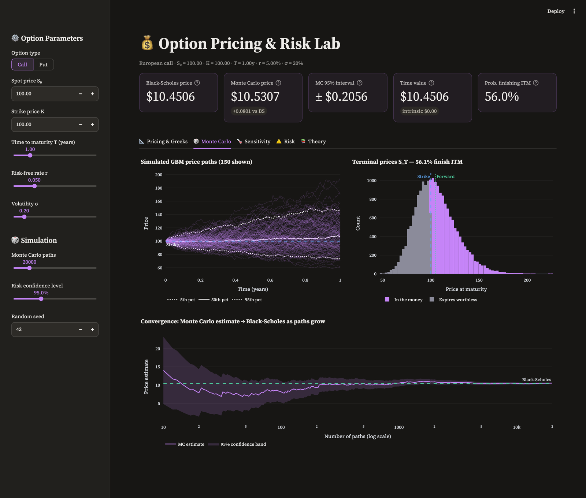
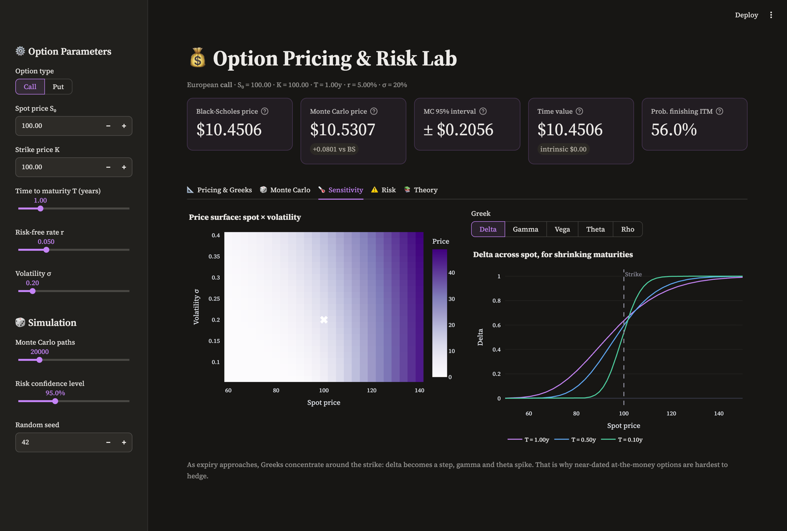
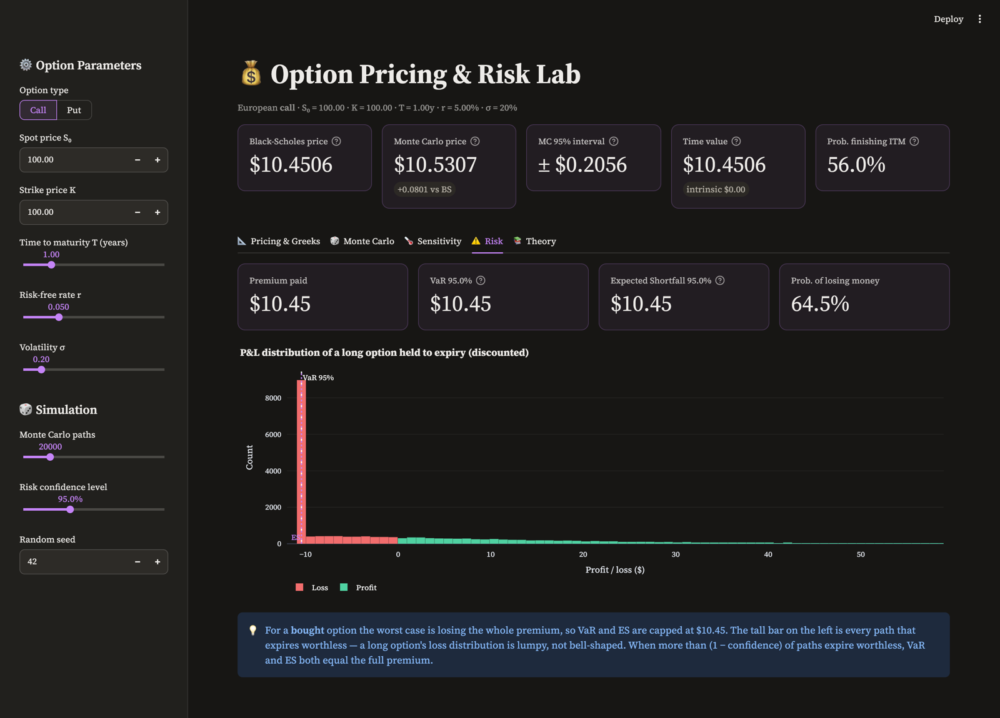
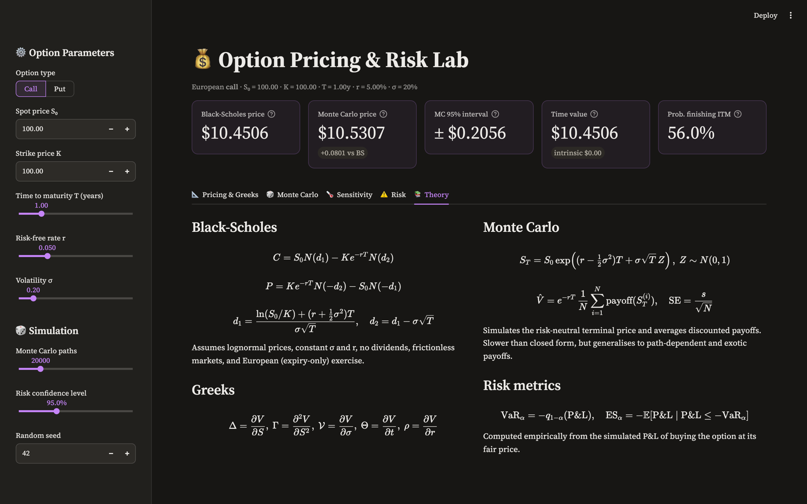
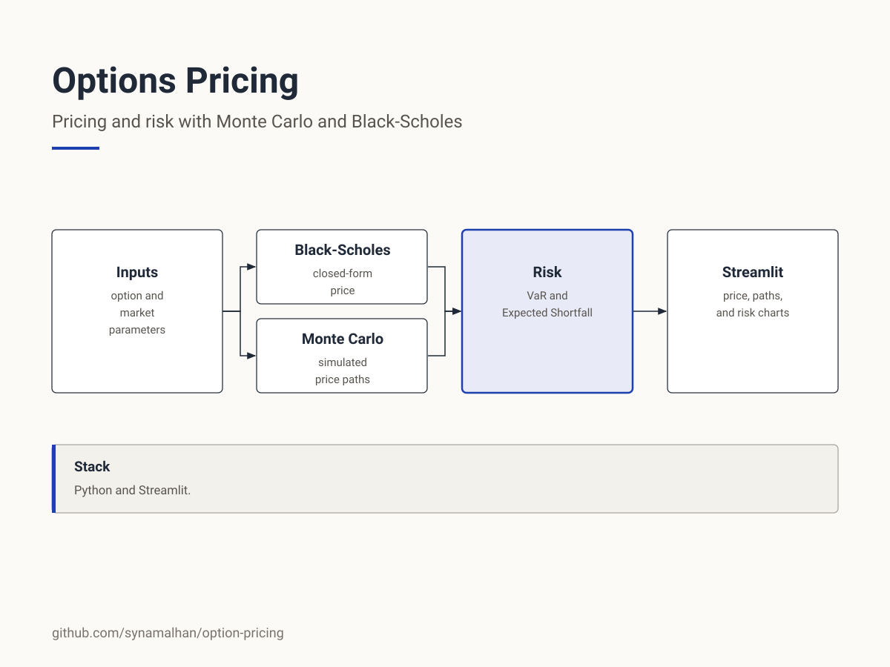

# 💰 Option Pricing & Risk Lab

An interactive Streamlit dashboard for pricing European options and studying their risk. It prices every option two ways, with the **closed-form Black-Scholes formula** and with **Monte Carlo simulation**. You can watch the simulation converge to the exact answer, see how the price reacts to each input, and measure the downside of holding the option.

<picture>
  <source media="(prefers-color-scheme: dark)" srcset="docs/overview-dark.png">
  <source media="(prefers-color-scheme: light)" srcset="docs/overview-light.png">
  
</picture>

---

## Contents

- [What it does](#what-it-does)
- [Results](#results)
- [A tour of the dashboard](#a-tour-of-the-dashboard)
- [Architecture](#architecture)
- [The maths](#the-maths)
- [Getting started](#getting-started)
- [Project structure](#project-structure)

---

## What it does

| | |
|---|---|
| **Two pricing engines** | An exact Black-Scholes price, and a Monte Carlo estimate with its 95% confidence interval |
| **All five Greeks** | Δ, Γ, ν, Θ and ρ, computed analytically and verified against finite differences |
| **Price decomposition** | Intrinsic value vs. time value, and the risk-neutral probability of finishing in the money |
| **Simulation insight** | Sample price paths, the distribution of terminal prices, and a convergence plot |
| **Sensitivity analysis** | A spot × volatility price heatmap, and Greek profiles as expiry approaches |
| **Risk metrics** | VaR and Expected Shortfall at a confidence level you choose, from the simulated P&L |

All inputs are in the sidebar: spot, strike, maturity, rate, volatility, number of paths, confidence level and random seed. Every chart and metric updates straight away. The seed makes the Monte Carlo results reproducible.

---

## Results

All numbers are measured on the reference contract (at-the-money call, S₀ = K = 100, T = 1y, r = 5%, σ = 20%, Black-Scholes price 10.4506). To regenerate the figure above, run `python docs/make_overview.py`.

| Check | Result |
|---|---|
| Monte Carlo error vs. N (300 seeds per N) | RMSE falls with fitted slope **−0.486**, close to the theoretical N^−½ |
| 95% confidence-interval coverage (1,000 runs, N = 10k) | **93.8%** of intervals contain the Black-Scholes price |
| Pricing error, strikes 70–130, N = 100k | At most 9¢. All puts, and calls with K ≤ 100, are inside their 95% CI. Calls with K ≥ 105 are slightly outside it, because every strike reuses the same simulated paths, so one low draw shifts them all together (panel d) |
| Analytic Greeks vs. finite differences | Max absolute error **< 1e-8** for both calls and puts |
| Put-call parity | Holds to machine precision |
| Speed | Monte Carlo with 10⁶ paths runs in about 25–55 ms; Black-Scholes prices 10⁶ options in about 60–130 ms (vectorised) |

---

## A tour of the dashboard

### 1. 📐 Pricing & Greeks

The top row compares the two engines. Black-Scholes gives the exact price, and the Monte Carlo card shows how far the simulation landed from it. The **MC 95% interval** card shows the simulation's own uncertainty, which shrinks with √N.

The chart plots the option's value today against its payoff at expiry. The **shaded gap is time value**: the premium you pay because the price can still move before expiry.



### 2. 🎲 Monte Carlo

- **Left:** 150 simulated geometric Brownian motion paths, with the 5th, 50th and 95th percentiles.
- **Right:** the distribution of terminal prices S_T. Paths that finish in the money are highlighted, and the strike and forward price are marked.
- **Bottom:** the running Monte Carlo estimate as more paths are added, with its 95% confidence band narrowing around the Black-Scholes price. This is the Law of Large Numbers in action.



### 3. 🌡️ Sensitivity

- **Heatmap:** the option price across a grid of spot and volatility values. The ✕ marks your current inputs.
- **Greek profiles:** pick any Greek and see it across spot prices at three maturities. As expiry approaches, delta becomes a step function while gamma and theta spike at the strike. This is why short-dated at-the-money options are the hardest to hedge.



### 4. ⚠️ Risk

This tab models the P&L of **buying the option at its fair price and holding it to expiry**. VaR and Expected Shortfall are read straight off the simulated distribution.

A long option's P&L is not bell-shaped. Every path that expires worthless loses exactly the premium, which creates the tall bar on the left. So your maximum loss is capped at the premium. VaR and ES both equal it whenever more paths expire worthless than the tail you are measuring.



### 5. 📚 Theory

A reference page with every formula the app uses.



---

## Architecture



The sidebar inputs feed both pricing engines in [models.py](models.py). The closed form gives the exact reference. The Monte Carlo engine produces the distribution of outcomes that the convergence plot and the risk metrics are built from.

---

## The maths

### Black-Scholes

$$C = S_0 N(d_1) - K e^{-rT} N(d_2) \qquad P = K e^{-rT} N(-d_2) - S_0 N(-d_1)$$

$$d_1 = \frac{\ln(S_0/K) + (r + \tfrac{1}{2}\sigma^2)T}{\sigma\sqrt{T}}, \qquad d_2 = d_1 - \sigma\sqrt{T}$$

The model assumes lognormal prices, constant volatility and interest rate, no dividends, frictionless markets and European (expiry-only) exercise.

### Greeks

| Greek | Measures | Units in the app |
|---|---|---|
| Δ Delta | ∂V/∂S: sensitivity to spot, also the hedge ratio | per $1 |
| Γ Gamma | ∂²V/∂S²: how fast delta changes | per $1 |
| ν Vega | ∂V/∂σ: sensitivity to volatility | per 1 vol point |
| Θ Theta | ∂V/∂t: time decay | per calendar day |
| ρ Rho | ∂V/∂r: sensitivity to interest rates | per 1% |

### Monte Carlo

Terminal prices are drawn under the risk-neutral measure:

$$S_T = S_0 \exp\left((r - \tfrac{1}{2}\sigma^2)T + \sigma\sqrt{T}\,Z\right), \quad Z \sim N(0,1)$$

$$\hat V = e^{-rT}\frac{1}{N}\sum_{i=1}^{N}\text{payoff}(S_T^{(i)}), \qquad \text{SE} = \frac{s}{\sqrt N}$$

Monte Carlo is slower than the closed form, but it extends directly to path-dependent and exotic payoffs where no formula exists.

### Risk metrics

$$\text{VaR}_\alpha = -q_{1-\alpha}(\text{P\&L}), \qquad \text{ES}_\alpha = -\mathbb{E}\left[\text{P\&L} \mid \text{P\&L} \le -\text{VaR}_\alpha\right]$$

Here P&L is the discounted payoff minus the premium paid. **VaR** is the loss that will not be exceeded with probability α. **Expected Shortfall** is the average loss in the tail beyond VaR.

---

## Getting started

```bash
git clone https://github.com/synamalhan/option-pricing.git
cd option-pricing
pip install -r requirements.txt
streamlit run option_pricing.py
```

The app opens at `http://localhost:8501`.

To check the pricing models (put-call parity, Greeks against finite differences, and Monte Carlo against Black-Scholes), run:

```bash
python test_models.py
```

---

## Project structure

```
option-pricing/
├── option_pricing.py      # Streamlit dashboard (UI, charts, risk metrics)
├── models.py              # Black-Scholes, Greeks, Monte Carlo, path simulation
├── test_models.py         # Self-checks for the pricing models
├── requirements.txt
├── .streamlit/config.toml # Dark theme with purple accent
└── docs/
    ├── overview-{dark,light}.png  # Results figure in both themes (built by make_overview.py)
    ├── make_overview.py
    ├── architecture.svg
    └── screenshots/       # Images used in this README
```

---

## Contributing

Issues and pull requests are welcome. Natural next steps include American options (binomial trees or Longstaff-Schwartz), dividend yield, implied-volatility solving and variance-reduction techniques such as antithetic variates.

## License

MIT
